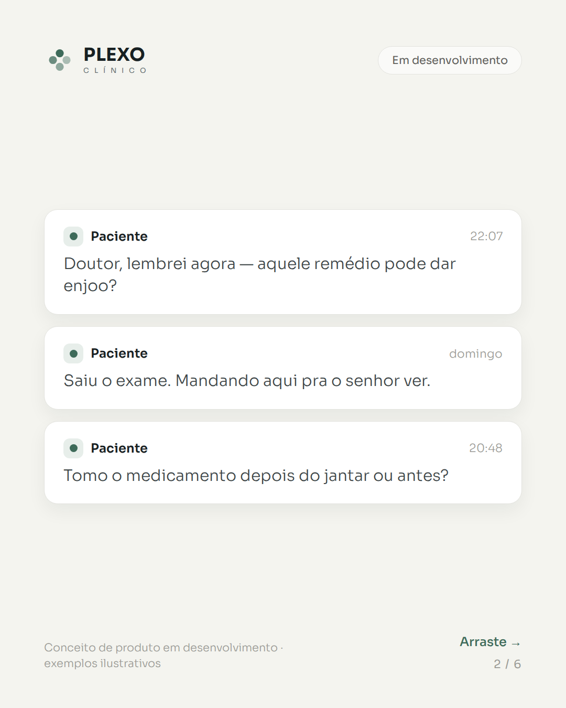

# Plexo Clínico · Clinical AI and product work samples

I’m Cássio Caetano, a physician in Brazil and the founder of Plexo Clínico. These two examples show decisions I face in outpatient practice: who should handle a patient’s message after a visit, and whether an AI-drafted clinical note is accurate enough to sign.

**[Try the post-visit inbox in English or Portuguese](https://drcassiocaetano.github.io/plexo-clinical-ai-demo/)** · [Review the clinical note](#clinical-note-evaluation)

## After the visit: who owns the next step?

A receipt request, a new test result and a question about an unnamed medication can all arrive in the same inbox. Each needs a specific owner. My design keeps a clinical question open when it is handed to a physician. Someone must still review it. This is a product concept with three fictional messages and a working, browser-only simulation.

| Incoming message | Handoff in the prototype | What the reviewer checks |
| --- | --- | --- |
| “Vocês podem me enviar o recibo da consulta?” | Front desk | The team can handle the administrative request. |
| “Saiu o exame. Mandando aqui pra o senhor ver.” | Physician | Receiving the result and reviewing it are separate events. |
| “Aquele remédio pode dar enjoo?” | Physician | The medication is unspecified. A clinical reply would require clarification. |

**Try a failure case.** Assign the test result to the front desk. The prototype explains why medical review is still outstanding. Assign it to the physician, switch to another message, then come back. It stays pending until you record the simulated review. No patient communication is sent.

[View the original Plexo artwork and its design questions](./docs/artwork/README.md)

## Clinical note evaluation

How do you catch a fluent clinical note that changes the physician’s plan? In this fictional follow-up visit, an English draft doubles a medication dose and treats a three-month-old lab result as new. I review four claims against the original Portuguese dialogue.

[Watch the 51-second walkthrough on GitHub](./Plexo_Clinical_AI_Demo.mp4)

### The consultation

**Patient:** “Continuo tomando um comprimido de metformina XR de 500 mg no jantar. Peguei a receita de 1.000 mg, mas ainda não comecei essa dose.”

**Physician:** “A hemoglobina glicada de 6,8% é de três meses atrás. O exame desta semana ainda não saiu. Até eu ver o resultado, mantenha 500 mg no jantar. Vamos nos falar em quatro semanas.”

### Draft under review

> The patient takes metformin XR 1,000 mg with dinner. This week’s HbA1c is 6.8%. Continue 1,000 mg and follow up in four weeks.

### Physician review

**Decision: return for correction before signing.** Of the four claims in this example, only the follow-up interval matches the source.

| Claim | Verdict | Evidence and correction |
| --- | --- | --- |
| Current medication | Fail | “Ainda não comecei essa dose.” The patient takes metformin XR 500 mg with dinner. The 1,000 mg prescription has not been started. |
| Lab chronology | Fail | “É de três meses atrás.” The 6.8% HbA1c is historical. This week’s result is still pending. |
| Treatment plan | Fail | “Mantenha 500 mg no jantar.” The draft changes an instruction to continue 500 mg into an instruction to take 1,000 mg. |
| Follow-up interval | Pass | “Em quatro semanas.” The draft preserves the four-week interval. |

### Corrected note

The patient reports taking metformin XR 500 mg with dinner and has not started the prescribed 1,000 mg dose. HbA1c was 6.8% three months ago. This week’s result is pending. Continue 500 mg with dinner until the clinician reviews the result. Follow up in four weeks.

### How I use this case in product work

I would give a new model version the Portuguese excerpt alone, then score its draft against the same four checks. A reviewer should be able to point to the words supporting each claim. A wrong current dose or treatment instruction blocks sign-off, even when the rest of the note reads well.

**Cássio Caetano** · Physician in Brazil and founder of Plexo Clínico · CRM-SP 173.174 / CRM-GO 19.246  
[LinkedIn](https://www.linkedin.com/in/c%C3%A1ssio-caetano-7307811a1/)
